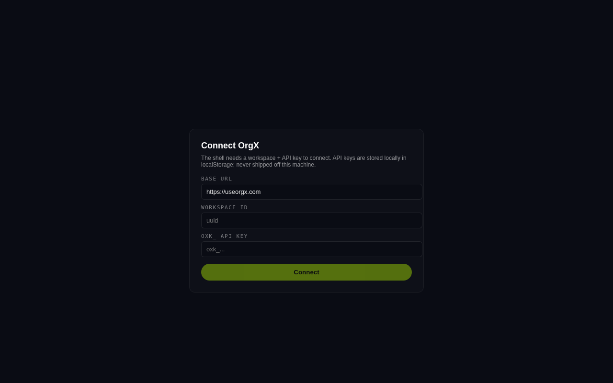
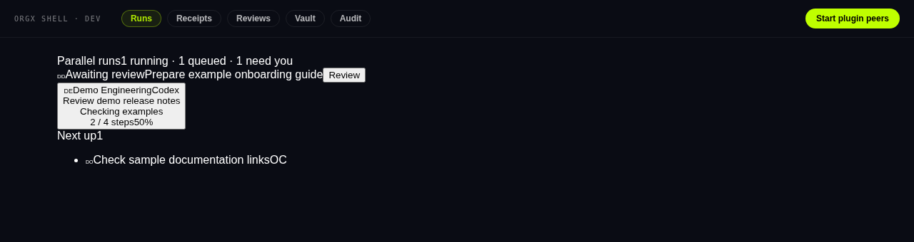

# OrgX local shell

For people reviewing local agent work, this alpha Tauri 2 desktop shell presents Runs, Receipts, Reviews, Vault/Budgets, and Audit views against a configured OrgX API. It also contains a native launcher for supported peer executables. The browser frontend is useful for development; it does not run native peers.

## UI preview





Captured from the current frontend with a local synthetic API fixture ([capture details](docs/images/preview-provenance.md)). [Open the live local frontend](http://127.0.0.1:5173/) after the quickstart. The [public OrgX demo](https://useorgx.com/live/demo) is a separate hosted experience. GitHub displays this screenshot; it cannot embed the desktop app. This capture verifies frontend rendering, not native packaging or peer execution. The form's current local-only credential wording is inaccurate; the actual transmission boundary is explained in [For agents](#for-agents).

## Quickstart

From a source checkout with Node.js and npm:

```bash
git clone https://github.com/useorgx/orgx-local-shell.git
cd orgx-local-shell
npm ci
npm run dev -- --host 127.0.0.1
```

Open `http://127.0.0.1:5173/` to inspect the connection form. No account is needed to build or view that form. Connected views require an OrgX API base URL, workspace ID, and API key with access to the intended workspace/endpoints.

For the native desktop app, install the [Tauri 2 platform prerequisites](https://v2.tauri.app/start/prerequisites/) and run `npm run tauri:dev`. Native packaging is a separate step; this repository is an alpha source project, not an npm-distributed desktop installer.

## Example: inspect a run's receipts

1. Enter the API base URL, workspace ID and authorized key in the connection form.
2. Open **Runs** to read the returned run state, then **Receipts** to inspect recorded outcomes and provider usage.
3. Compare a receipt's `run_id` and outcome with the underlying OrgX work record. Open **Reviews** for judgments that need a person.

**Success:** the API returns records for your authorized workspace and the UI shows the corresponding runs/receipts. An empty list is valid for an empty workspace; it is not proof that a connection succeeded. Confirm a real API response before concluding there is no work. A "shipped" outcome in a receipt or a "Peers running" badge is not independent verification of delivery or peer health.

The screenshot uses a browser-side synthetic fixture API; there is no shipped `--demo` flag. Entering real credentials is not needed to reproduce a fixture capture.

## Docs and troubleshooting

- [Frontend tabs, configuration and requests](src/App.tsx), [native commands](src-tauri/src/main.rs), and [native capabilities](src-tauri/capabilities/default.json) are the shipped implementation references.
- Development checks: `npm run type-check` and `npm run build`. Browser preview after build: `npm run preview -- --host 127.0.0.1`.
- Blank lists can reflect an empty response or a failed request; the current tab implementation does not surface every fetch error. Check browser network status, workspace access, base URL and API auth. Some shared surfaces currently lack their expected Tailwind styling; the preview shows the shipped alpha layout.
- The browser build labels its version `dev` when Tauri IPC is unavailable. **Start plugin peers** needs the native runtime and the expected executables; use the relevant peer's logs and OrgX state to verify it.
- The configured native window is desktop-sized (minimum 960 × 600). Rust/Tauri platform packaging and signed installers were not verified by a frontend build.

## For agents

The shell is an application, not an MCP server or a new agent CLI. Discover the supported npm scripts in [package.json](package.json), tabs and request shapes in [src/App.tsx](src/App.tsx), and native commands in [src-tauri/src/main.rs](src-tauri/src/main.rs). Use the respective peer plugins' supported setup for agent integration; do not invent a shell MCP endpoint.

The configuration is stored in `localStorage`. The key is sent as `Authorization: Bearer …` to the configured API and is passed to native peer processes when a person starts them; it is not confined to the machine or stored in an OS keychain. Keep credentials out of prompts, fixtures, logs and screenshots. Permissions belong to the configured API and peer, not to a visible UI control. The Runs request currently omits a workspace query parameter; the API/key's scope remains authoritative. The checked-in native CSP permits connections to `useorgx.com`; a custom base URL that works in a browser can still be outside that native allowlist.

Scope read workflows to the intended workspace and inspect server results. **Reviews** can POST a judgment resolution; peer launch starts local processes. Treat those as authorized actions, not passive reads. The Rust launcher passes `ORGX_API_KEY` and `ORGX_WORKSPACE_ID`, but a successful process spawn or UI badge does not prove gateway admission or task completion.

For development, build the frontend, exercise the affected tab against a synthetic API, and verify its request shape and displayed result. A useful invocation is: "Inspect Runs and Receipts with local synthetic records, keep API credentials out of artifacts, and report frontend, native-runtime and live-service verification separately."

## Costs and license status

No open-source license is declared in this public repository. The local frontend build/connection form needs no paid model or hosted plan. Connected workflows require an OrgX account under [its Free or paid plans](https://useorgx.com/pricing); coding-client subscriptions or provider/model usage are separate. The shell has no checkout or agent purchasing API.

## Architecture

```text
Tauri window → React UI → configured OrgX API
             → native start_peer command → permitted peer executable
```

The tray menu can show the window or quit. Native peer launch is explicit. The source uses Tauri 2 and a native WebView; bundle sizes and signed distribution are not established by the checked-in configuration.

## Peer launch configuration

The native `start_peer` command maps these plugin IDs to executable names:

| Plugin ID | Executable |
| --- | --- |
| `@useorgx/claude-code-plugin` | `orgx-claude-code-peer` |
| `@useorgx/codex-plugin` | `orgx-codex-peer` |
| `@useorgx/orgx-opencode-plugin` | `orgx-opencode-plugin` |

The capability file permits those commands. Ensure the matching peer executable is installed and available to the native runtime. The current Tauri bundle configuration does not declare packaged peer binaries; the launcher mappings alone do not prove that an installer includes them. See the public [Claude Code](https://github.com/useorgx/orgx-claude-code-plugin), [Codex](https://github.com/useorgx/orgx-codex-plugin), and [OpenCode](https://github.com/useorgx/orgx-opencode-plugin) projects for their current supported distribution.

## Build targets and status

`npm run tauri:build` uses the configured `.dmg`, `.AppImage`, and `.msi` targets on an appropriate platform. Icons are under `src-tauri/icons/`; signing, platform prerequisites and working peer binaries require separate verification. Alpha status is unchanged.
